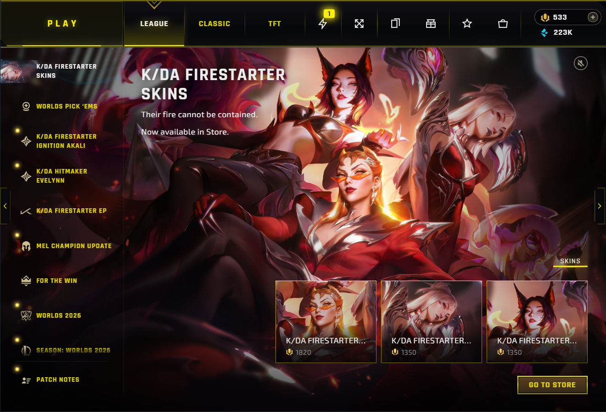

**Made by Korbax.** His GitHub account is no longer available, so this repo hosts the theme for him. All credit goes to Korbax.

A complete Cyberpunk 2077-style makeover for the League client. Neon yellow and red on black glass, sharp cut corners, glitch effects and Breach Protocol animations, on every screen: home, lobby, champ select, profile, chat, Loot, Collection and more.

## Features
- **Cyberpunk look everywhere**, with colour presets: Cyberpunk, Netrunner, Arasaka, Militech, Kiroshi, or your own colours
- **Your own cosmetics** (only you see them): wallpaper (image, GIF, WebP or video), profile picture, icon borders, banners, title and profile background
- 10 bundled icon borders and 11 banners, some animated
- **Animations:** Breach Protocol sequences for lobbies, player cards that decode in and out, a glitching match found screen
- **TFT match history** with placements, comps and augments
- **Status changer**, friends sorted by in game, online, offline, and invite all friends
- **Sound pack:** soft sci-fi sounds for lobby, queue, match found, champ select, lock in and chat
- **Lightweight mode** for weaker PCs, and no background work while you're in game

## Install
1. Download `CyberpunkTheme.zip` from the post and extract it
2. Double-click `Install.cmd`. It finds Pengu Loader and copies the theme into its `plugins` folder
3. Fully restart the League client

Or move the `CyberpunkTheme` folder into your Pengu Loader `plugins` folder by hand.

## Settings
Open the client **Settings**. The new **CustomClient** tab has all the options: wallpaper, picture, borders, banners, title, colours, sounds and more.

To add your own pictures, open the folder from the plugin settings, drop the files in, then double-click `_Refresh list.cmd` in that folder.

## Good to know
- Custom pictures, borders, banners and titles show on your client only
- Your status, status message and the rank shown in chat are visible to friends
- No auto-accept, auto-queue or dodge. It only changes how the client looks and sounds

## Support
Questions or bugs: reply in this thread.
