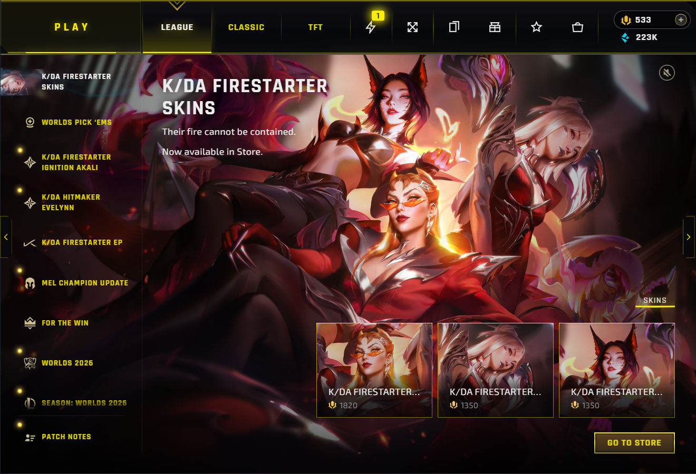

# Cyberpunk theme for Pengu Loader

> **Made by Korbax** ([othkourbi](https://github.com/othkourbi) on GitHub). Korbax's GitHub account is no longer available, so this repo hosts the theme for him. All credit for the theme goes to Korbax.

A complete Cyberpunk 2077-style makeover for the League of Legends client, made as a
[Pengu Loader](https://pengu.lol) plugin. Neon yellow and red on black glass, sharp cut
corners, glitch effects and Breach Protocol animations. Every screen is restyled to
match: home, lobby, champ select, profile, chat, Loot, Collection and more.

On top of the look, it adds your own wallpapers, profile picture, icon borders, banners and
title. It also adds a TFT match history you can browse, a status changer, soft
sci-fi sounds and loading screens that hide the client's default look while pages load.

<p align="center">
  <a href="https://github.com/Ku-Tadao/cyberpunk-theme-pengu-loader/releases/latest/download/CyberpunkTheme.zip">
    
  </a>
</p>



## Features

### Look
- **Cyberpunk theme everywhere:** a palette swap for every Riot screen, plus hand-made
  styles for the top bar, Play button, lobby, champ select, match found, chat, friends list,
  profile, hover cards, Loot, Collection, notifications and dialogs.
- **Colour presets:** Cyberpunk, Netrunner, Arasaka, Militech and Kiroshi, or your own colours.
- **Fonts:** Rajdhani and Exo 2, used across the client (optional).
- **Glass blur, scanlines and glow,** each with its own setting.

### Your own cosmetics
These are drawn on your client only. Other players still see your normal profile.

- **Custom wallpaper:** images, GIFs, animated WebP or video.
- **Custom profile picture:** GIFs play at full length, and the picture replaces your icon everywhere.
- **Icon borders:** CSS rings plus 10 bundled image borders, 5 of them animated.
- **Banners:** 11 bundled Cyberpunk banners, 5 of them animated.
- **Custom title** with style options, and a **profile background** that also shows on your hover card.
- **Replaces Riot's version:** every custom piece takes the place of Riot's, so you never see both.

To add your own files, open the folder from the plugin settings, drop the files in, then
double-click `_Refresh list.cmd` in that folder. They appear in the client within a few
seconds; no reload needed.

### Animations
- **Breach Protocol sequences** when you create, join or leave a lobby.
- **Player cards decode in** when someone joins, and **decode out in reverse** when they leave,
  with their names shown. Several players joining at once are handled cleanly.
- **Match found:** a glitching "MATCH FOUND" title and a shockwave.
- **Loading screens between pages** (and on your player card), so the client's default look
  never flashes before the theme is applied.

### Features
- **TFT match history:** placements, comps and augments for every player in a game. Click
  any player to open their profile.
- **Status changer:** click the dot next to your name to switch between online, away, in game and offline. Also sets a custom
  status message.
- **Friends list:** shows friends in game first, then online, then offline.
- **Hide panels:** an edge arrow slides the friends list away (the top bar and panels slide to
  the edge with it), and another hides the page content to show off your wallpaper.
- **Invite all friends** to your lobby.
- **Sound pack:** soft, quiet sci-fi sounds, a different one for each event. That covers lobby
  create, join and leave, Find Match, match found, champ select, lock in, level up, and
  separate private and lobby chat sounds. Clicks and notifications stay silent.

### Performance
- **No work when hidden:** background work pauses while the client is minimized or a game is
  running. The wallpaper is also hidden in game, so the client leaves your GPU to the game.
- **Only when needed:** checks only run after the page actually changes.
- **Lightweight mode** for weaker PCs: turns off the glass blur and moving effects.

## Install

1. Install [Pengu Loader](https://pengu.lol) and activate it for League of Legends.
2. Click **[Download CyberpunkTheme.zip](https://github.com/Ku-Tadao/cyberpunk-theme-pengu-loader/releases/latest/download/CyberpunkTheme.zip)** and extract it.
3. Double-click **`Install.cmd`** in the extracted folder. It finds Pengu Loader, copies the
   theme into its `plugins` folder and asks for administrator rights only if that folder needs them.
4. Fully restart the League client.
5. Open the client **Settings**. There is a new **CustomClient** tab with all the options
   (wallpaper, picture, borders, banners, title, colours, sounds and so on).

**To update,** download the zip again and run `Install.cmd`. It updates your existing install
and keeps your own pictures.

**One-line install:** paste this into PowerShell instead of steps 2 and 3:

```powershell
irm https://raw.githubusercontent.com/Ku-Tadao/cyberpunk-theme-pengu-loader/main/install.ps1 | iex
```

**By hand:** move the `CyberpunkTheme` folder from the zip into `Pengu Loader/plugins/`.

## Good to know

- **Client-side only:** custom pictures, borders, banners, titles and backgrounds are drawn on
  your own client. Other players don't see them.
- **What friends do see:** your status, status message and the rank shown in chat are sent to
  your friends, like other status changers do.
- **No gameplay automation:** no auto-accept, auto-queue or dodge. It only changes how the client looks and sounds.
- **Riot updates:** a client patch can rename parts of the interface. If something stops being
  themed, please open an issue with a screenshot.
- **Diagnostics:** the plugin saves short outlines of a few client screens to Pengu's local storage, to help fix
  layout issues. Nothing is sent anywhere.

## Credits

- **Fonts:** [Rajdhani](https://fonts.google.com/specimen/Rajdhani) and
  [Exo 2](https://fonts.google.com/specimen/Exo+2), under the SIL Open Font License (see `assets/fonts/OFL-rajdhani.txt` and `assets/fonts/OFL-exo2.txt`).
- **Generated assets:** the bundled borders, banners and sounds were made for this project.
- **Inspiration:** ElainaV4 and ReimaginedLC.
- **Theme by:** Korbax ([othkourbi](https://github.com/othkourbi)). Hosted by [Ku-Tadao](https://github.com/Ku-Tadao).

## License

MIT, see [LICENSE](LICENSE). The bundled fonts keep their own SIL Open Font License.

This is a fan project. It isn't endorsed by Riot Games and doesn't reflect the views or opinions of Riot Games or anyone
officially involved in producing or managing League of Legends. League of Legends is a
trademark of Riot Games, Inc. Cyberpunk 2077 is a trademark of CD PROJEKT S.A.; this project
isn't affiliated with CD PROJEKT.
